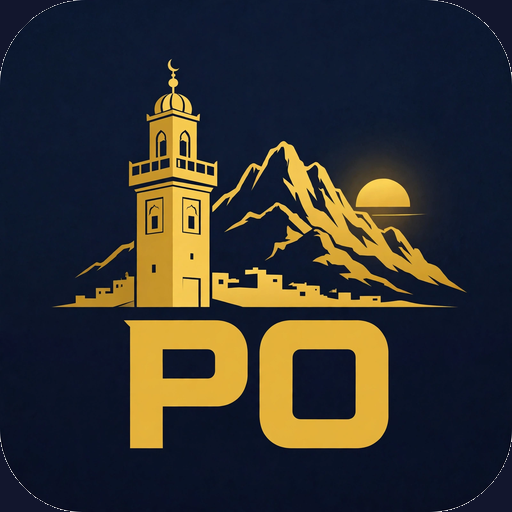

<div align="center">



# 🎮 PHANTOM OPS

### Kasserine Operations — a police FPS set in Kasserine, Tunisia

[](https://godotengine.org)
[](https://github.com/Gass-OS/Phantom-Ops/actions)
[](https://github.com/Gass-OS/Phantom-Ops)
[](https://github.com/Gass-OS/Phantom-Ops/actions)

**You are a police officer in Kasserine. Patrol the city, protect its people, take on missions — and bring down the gang that calls itself the Wolves of Kasserine.**

</div>

---

## 📖 What it is

**Phantom Ops** is a mobile first-person shooter built with **Godot 4.2** (Mobile renderer) for **Android arm64**. The whole city is generated procedurally at runtime — 70+ buildings, streets, market, mosque, traffic and citizens — with procedural textures, sounds and a golden-hour dusk look.

One thing is not procedural: **the hero is Aymen's own 3D scan** (`project/assets/characters/aymen_pbr.glb`), standing in the menu and the intro as the officer you play. He is the hero only — never an enemy or a target.

- 🗺️ **A living Kasserine** — procedural city, mosque with teal dome and minarets, medina domes, market stalls, palms, fountain, benches, bus stops
- 👮 **You are the police** — missions, ranks, money in Tunisian dinars (DT), a drivable police car with siren and lights
- 🕌 **Respectful detail** — real adhan recording at dusk, Tunisian citizens in jebba and hijab, greetings in Tunisian Arabic, French and English
- 🌙 **Day & night** — 4-minute cycle, rain, thunder and lightning, lamps and lit windows at night
- 🎯 **Story campaign** — 5 chapters against a gang, with a boss fight, ranks and saves

---

## 🆕 Current version — v0.7.0 "Story Campaign"

### 📚 The campaign: The Wolves of Kasserine

| Chapter | Title | What happens |
|:---:|---|---|
| 1 | **First Patrol** | Learn the city, your first missions |
| 2 | **The Souk Robbery** | A robbery in the market — respond fast |
| 3 | **Night Shift** | A full night patrol, rain and dark streets |
| 4 | **The Informant** | Find the suspicious citizen in the crowd |
| 5 | **The Wolf** | Boss fight against **Khaled "The Wolf"** at the plaza |

- 🐺 **Boss Khaled** — 500 HP, charge attacks, calls 2 guards at half health, with a boss health bar
- 🎖️ **Ranks** — Officer → Sergeant → Lieutenant → Captain, earned with XP (never a gate — play any unlocked chapter)
- 💾 **Save system** — progress saves automatically; **CONTINUE** picks up where you left off, chapter select replays finished chapters
- 🎬 **Cutscenes** — chapter intro cards, results and ending cards (SKIP anytime)
- 💀 **Death flow** — a YOU DIED screen with RETRY (restarts the chapter) and MAIN MENU, never a dead end

### 🚔 Police life

- **Missions** — RESPOND, HELP, CHASE and PATROL, with a beacon, DT rewards and XP
- **Citizens** — 24 Tunisians walking the city: chat pairs, speech bubbles, funny characters, poor citizens asking for help, and suspicious ones (~15% are criminals in disguise). HELP, GIVE or CHECK them — they are never targets
- **Traffic** — 10 cars with engine sounds, plus your **drivable police car** (siren, flashing lights, enter/exit)
- **Day & night** — sun cycle, occasional rain with thunder and lightning, street lamps and lit windows after dark
- **Adhan** — a real recording plays once at dusk from the mosque (can be toggled off)
- **Languages** — full French / English / Arabic, including Arabic script

### 🎮 Controls (touch)

| Control | Action |
|:---|---|
| Left joystick | Move |
| Drag on screen | Look around |
| **FIRE** | Shoot (hold to keep firing) |
| **JUMP** / **RUN** | Jump / sprint |
| **Interact** | Talk, help, check citizens — enter the police car |
| **Pause** | Pause menu, sound & voices, quit to menu |

---

## 🔜 Coming next — v0.8 "Weapons + Wanted" (in progress)

5 weapons (Pistol, Rifle, SMG, Shotgun, Sniper with scope zoom), an armoury, real ammo with reloads and pickups, and a 5-level wanted/heat system that sends tougher enemies after you. Not shipped yet — v0.7 is the current release.

---

## 📦 Get the game

Every push to `main` builds an APK with GitHub Actions — download **`PhantomOps-Release-APK`** from the latest successful run's artifacts ([Actions page](https://github.com/Gass-OS/Phantom-Ops/actions)). Current APK is about **60 MB**.

> The game is not on Google Play yet — the CI artifact is the way to install it for now.

---

## 🛠️ Build it yourself

```bash
git clone https://github.com/Gass-OS/Phantom-Ops.git
cd Phantom-Ops
# Open project/project.godot with Godot 4.2.2 (Mobile renderer)
# Android export: arm64-v8a, package com.phantomops.kasserine
```

Pushing to `main` triggers the same build in CI — no local Android SDK needed.

### Project layout

```
project/
├── scenes/        # main_menu, intro (drone cinematic), main_game
├── scripts/       # city generator, campaign, missions, citizens, traffic, AI
├── assets/
│   ├── characters/  # Aymen's 3D scan — aymen_pbr.glb (hero) + LowPoly fallback
│   └── audio/       # adhan.ogg (real recording, CC0)
├── icon.png       # 512×512 gold minaret icon
└── export_presets.cfg
```

### A note for developers

Rendering is deliberately Mobile-safe: colour background + colour ambient, Filmic tonemapping, **no ProceduralSky, no fog, no ACES, no MSAA** — those broke rendering on real phones in v0.2 (pure black screen). Keep it that way. `scripts/weather.gd`, `scripts/main_game.gd` and `scripts/world_spawner.gd` exist in the tree but are **not attached to any scene** — don't re-attach them.

---

## 📜 Version history

| Version | Highlights |
|:---:|---|
| **0.7.0** | Story campaign, boss Khaled, ranks, saves |
| 0.6.0 | Police missions, FR/EN/AR, adhan, day/night + rain, police car, 60 MB |
| 0.5.0 | Death flow fixed, GTA IV-style dusk look |
| 0.4.0 | Drone intro, live 3D menu, mosque, citizens, voices, icon |
| 0.3.0 | Working FIRE, big HUD, procedural sounds |
| 0.2.1 | Black-screen fix (Mobile-safe rendering) |
| 0.2.0 | First playable city — 300 m, 77 buildings, waves |

---

<div align="center">

**Made with Godot in Kasserine, Tunisia 🇹🇳**

*Aymen's own 3D scan is the hero of this game — the officer you play, never a target.*

</div>
